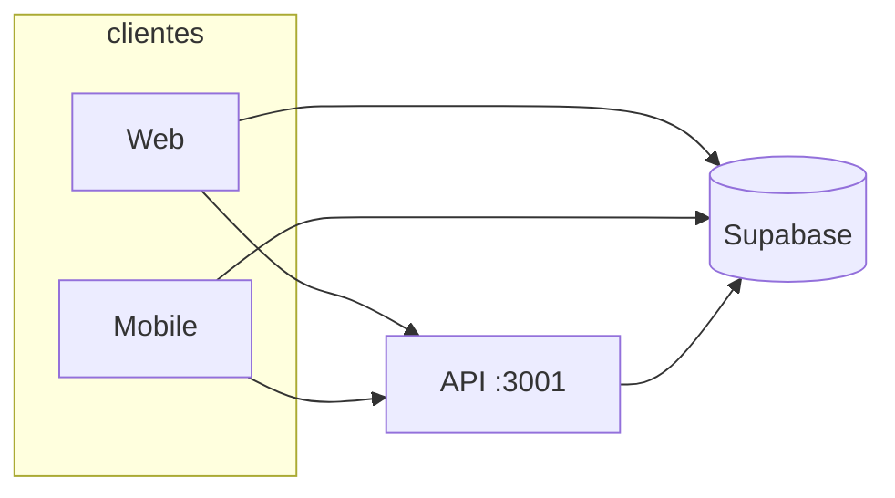

# Controle de Abastecimento

Sistema para registrar, auditar e analisar abastecimentos de **tanque em obra** e **melosa (caminhão-tanque)**. Monorepo com API REST, painel web (dashboard + BI) e app mobile com sincronização offline.

**Desenvolvido por:** [Larissa Prata — @larialprata](https://github.com/larialprata) · **Licença:** (repositório público — outras pessoas podem usar e adaptar)

---

## Estrutura do projeto

Árvore completa do repositório (como no explorador de arquivos do GitHub).  
**Não versionados** (`.gitignore`): `node_modules/`, `dist/`, `.env`, `.expo/`, `android/`, builds e caches.

```
controle-abast/
│
├── .editorconfig
├── .gitignore
├── LICENSE                      # MIT — uso livre com atribuição
├── package.json                 # workspaces npm (api + web + mobile)
├── README.md
│
├── api/                         # Backend Express + Supabase
│   ├── .env.example
│   ├── .gitignore
│   ├── package.json
│   ├── tsconfig.json
│   ├── README.md
│   │
│   ├── src/
│   │   ├── index.ts
│   │   ├── config.ts
│   │   ├── lib/
│   │   │   └── supabase.ts
│   │   ├── middleware/
│   │   │   ├── requireAuth.ts
│   │   │   └── requireAdmin.ts
│   │   ├── routes/
│   │   │   ├── admin.ts
│   │   │   ├── auth.ts
│   │   │   ├── equipamentos.ts
│   │   │   ├── mobileErrors.ts
│   │   │   ├── movimentacoes.ts
│   │   │   └── obras.ts
│   │   └── scripts/
│   │       ├── seedAdmin.ts
│   │       └── confirmUserEmail.ts
│   │
│   └── supabase/
│       ├── README.md
│       ├── schema.sql
│       ├── storage-buckets.sql
│       ├── migration_melosa_categoria.sql
│       ├── migration_melosa_completo.sql
│       ├── migration_melosa_horimetro_equipamento_abastecido.sql
│       ├── migration_melosa_lacre_medidor_final.sql
│       ├── migration_melosa_motorista_operador.sql
│       ├── migration_placa_fornecedor_tanque.sql
│       └── migration_remover_horimetro_e_legado.sql
│
├── web/                         # Frontend React + Vite + Tailwind
│   ├── .env.example
│   ├── .gitignore
│   ├── package.json
│   ├── index.html
│   ├── vite.config.ts
│   ├── eslint.config.js
│   ├── tsconfig.json
│   ├── tsconfig.app.json
│   ├── tsconfig.node.json
│   ├── README.md
│   │
│   ├── public/
│   │   ├── favicon.png
│   │   ├── favicon.svg
│   │   ├── icons.svg
│   │   ├── dimensional-logo.png
│   │   └── templates/
│   │       └── planilha-melosa-descarbonize.xlsx
│   │
│   ├── scripts/
│   │   └── create-melosa-excel-template.mjs
│   │
│   └── src/
│       ├── main.tsx
│       ├── App.tsx
│       ├── App.css
│       ├── index.css
│       ├── assets/
│       │   ├── hero.png
│       │   ├── react.svg
│       │   └── vite.svg
│       ├── pages/
│       │   ├── LoginPage.tsx
│       │   ├── HomePage.tsx
│       │   ├── DadosPage.tsx
│       │   ├── ContratosPage.tsx
│       │   ├── UsersPage.tsx
│       │   ├── TanqueBIPage.tsx
│       │   └── MelosaBIPage.tsx
│       ├── components/
│       │   ├── ErrorBoundary.tsx
│       │   ├── ThemeToggle.tsx
│       │   ├── bi/
│       │   │   ├── MovementsMap.tsx
│       │   │   ├── TanqueTicketModal.tsx
│       │   │   ├── MelosaTicketModal.tsx
│       │   │   ├── NotaPhotoCell.tsx
│       │   │   ├── MelosaPhotosCell.tsx
│       │   │   ├── StoragePhotoCell.tsx
│       │   │   └── ImagePanZoomLightbox.tsx
│       │   └── dashboard/
│       │       ├── DashboardLayout.tsx
│       │       ├── DashboardCard.tsx
│       │       ├── Sidebar.tsx
│       │       └── MelosaAtivoResumoModal.tsx
│       ├── lib/
│       │   ├── api.ts
│       │   ├── supabase.ts
│       │   ├── env.ts
│       │   ├── glass.ts
│       │   ├── biSelection.ts
│       │   ├── combustivelControle.ts
│       │   ├── melosaAtivoResumo.ts
│       │   ├── aggregateCombustivelDashboard.ts
│       │   ├── descarbonizeExcel.ts
│       │   ├── melosaDescarbonizeExcel.ts
│       │   ├── tanqueDescarbonizeExcel.ts
│       │   ├── storageNota.ts
│       │   └── storageMelosa.ts
│       └── state/
│           ├── AuthContext.tsx
│           └── ThemeContext.tsx
│
├── mobile/                      # App Expo / React Native (campo)
│   ├── .env.example
│   ├── .gitignore
│   ├── package.json
│   ├── app.json
│   ├── eas.json
│   ├── App.tsx
│   ├── index.ts
│   ├── tsconfig.json
│   ├── network_security_config.xml
│   ├── README.md
│   │
│   ├── assets/
│   │   ├── icon.png
│   │   ├── splash-icon.png
│   │   ├── favicon.png
│   │   ├── logo_compacto.png
│   │   ├── home_carbono.png
│   │   ├── android-icon-foreground.png
│   │   ├── android-icon-background.png
│   │   └── android-icon-monochrome.png
│   │
│   ├── scripts/
│   │   ├── setup-short-path.ps1
│   │   └── run-android-windows.ps1
│   │
│   └── src/
│       ├── constants/
│       │   └── obras.ts
│       ├── db/
│       │   └── sqlite.ts
│       ├── lib/
│       │   ├── api.ts
│       │   ├── supabase.ts
│       │   ├── env.ts
│       │   └── readImageUri.ts
│       ├── sync/
│       │   └── syncOutbox.ts
│       ├── theme/
│       │   └── light.ts
│       └── types/
│           └── movimentacao.ts
│
└── docs/
    ├── README.md
    ├── mobile-android-build.md
    └── samples/
        ├── README.md
        └── Planilha.xlsx
```

| Pacote | Pasta | Documentação |
|--------|-------|----------------|
| API | [`api/`](api/) | [`api/README.md`](api/README.md) · SQL em [`api/supabase/`](api/supabase/) |
| Web | [`web/`](web/) | [`web/README.md`](web/README.md) |
| Mobile | [`mobile/`](mobile/) | [`mobile/README.md`](mobile/README.md) |



### Funcionalidades

- **Tanque:** entradas/retiradas, medidor, lacres, NF, fotos.
- **Melosa:** retiradas por ativo/placa, medidor acumulado, comprovantes, fechamento e desvio.
- **Web:** dashboard, BI tanque/melosa, tickets, mapa, export Excel Descarbonize.
- **Mobile:** formulários em campo, GPS, fotos, SQLite + fila offline.

---

## Pré-requisitos

- [Node.js](https://nodejs.org/) 20+
- Projeto [Supabase](https://supabase.com/)
- (Opcional) Google Maps API para mapa no BI
- Mobile: Android Studio ou Expo Go

---

## Instalação rápida

### 1. Dependências (raiz ou por pacote)

Na raiz (instala os três workspaces):

```bash
npm install
```

Ou em cada pasta: `api/`, `web/`, `mobile/`.

### 2. Supabase

Execute no SQL Editor, nesta ordem:

1. [`api/supabase/schema.sql`](api/supabase/schema.sql)
2. [`api/supabase/storage-buckets.sql`](api/supabase/storage-buckets.sql)

Detalhes: [`api/supabase/README.md`](api/supabase/README.md).

### 3. Variáveis de ambiente

Copie os exemplos — **nunca** commite `.env`:

```bash
cp api/.env.example api/.env
cp web/.env.example web/.env
cp mobile/.env.example mobile/.env
```

| App | Arquivo | Variáveis |
|-----|---------|-----------|
| API | `api/.env` | `SUPABASE_URL`, `SUPABASE_ANON_KEY`, `SUPABASE_SERVICE_ROLE_KEY`, `PORT` |
| Web | `web/.env` | `VITE_SUPABASE_URL`, `VITE_SUPABASE_ANON_KEY`, `VITE_API_URL`, opcional `VITE_GOOGLE_MAPS_API_KEY` |
| Mobile | `mobile/.env` | `EXPO_PUBLIC_SUPABASE_URL`, `EXPO_PUBLIC_SUPABASE_ANON_KEY`, `EXPO_PUBLIC_API_URL` |

### 4. Subir os serviços

```bash
# Terminal 1 — API
npm run dev:api
# ou: cd api && npm run dev

# Terminal 2 — Web
npm run dev:web
# ou: cd web && npm run dev

# Terminal 3 — Mobile (opcional)
npm run dev:mobile
```

Healthcheck: `GET http://localhost:3001/health`

**Primeiro admin:**

```bash
npm run seed:admin
# ou: cd api && npm run seed:admin
```

---

## Scripts na raiz

| Script | Ação |
|--------|------|
| `npm run dev:api` | API com reload |
| `npm run dev:web` | Vite dev server |
| `npm run dev:mobile` | Expo |
| `npm run build:api` | Compila API |
| `npm run build:web` | Build produção web |
| `npm run seed:admin` | Cria usuário administrador |

---

## Publicar no GitHub

O [`.gitignore`](.gitignore) exclui `.env`, `node_modules/`, `dist/`, builds Android, bug reports e caches.

Antes do push:

```bash
git status
```

Não deve listar `api/.env`, `web/.env`, `mobile/.env` nem pastas `dist/`.

| Chave | Onde | Commitar? |
|-------|------|-----------|
| `SUPABASE_ANON_KEY` | web, mobile | Não (ficar só no `.env` local) |
| `SUPABASE_SERVICE_ROLE_KEY` | **somente** API | **Nunca** |
| `VITE_GOOGLE_MAPS_API_KEY` | web | **Nunca** |

Se um `.env` já tiver sido commitado, **rotacione** as chaves no Supabase/Google antes de publicar.

Repositório **público** no perfil [@larialprata](https://github.com/larialprata):

```bash
git add .
git commit -m "Monorepo: API, web e mobile"
git remote add origin https://github.com/larialprata/controle-abast.git
git push -u origin main
```

No GitHub: **Settings → General → Change visibility → Public** (se ainda estiver privado).

---

## Conceitos de litros

- **Tanque — retirada:** medidor final − inicial.
- **Melosa — abastecimento:** medidor inicial − final.
- **Fechamento melosa:** margem padrão 3,5% (`limiteAceitavelPct`).

Código: `web/src/lib/combustivelControle.ts`, `melosaAtivoResumo.ts`.

---

## Solução de problemas

| Sintoma | Verificar |
|---------|-----------|
| `Missing env vars` | `api/.env` completo |
| `Invalid API key` | Mesmo projeto Supabase em todos os `.env` |
| `Perfil inativo` | Admin ativa em `/usuarios` |
| Mapa vazio | `VITE_GOOGLE_MAPS_API_KEY` em `web/.env` |
| Mobile sem API | `EXPO_PUBLIC_API_URL` com IP da rede, não `localhost` |
| Build Android Windows | [`docs/mobile-android-build.md`](docs/mobile-android-build.md) |

---

## Autoria

Projeto desenvolvido por **[Larissa Prata](https://github.com/larialprata)** 

---

## Licença

**[MIT](LICENSE)** — código aberto no perfil [larialprata](https://github.com/larialprata).

O projeto nasceu para controle de abastecimento em obra (tanque e melosa), mas está **público no GitHub** para estudo, portfólio e reutilização. Outras pessoas podem usar, modificar e distribuir, desde que mantenham o aviso de copyright e a licença MIT nos derivados.

**Ao reutilizar:** configure seu próprio Supabase e `.env` (nunca use as chaves de outro ambiente). Crédito à autora é apreciado — link para [github.com/larialprata](https://github.com/larialprata).
